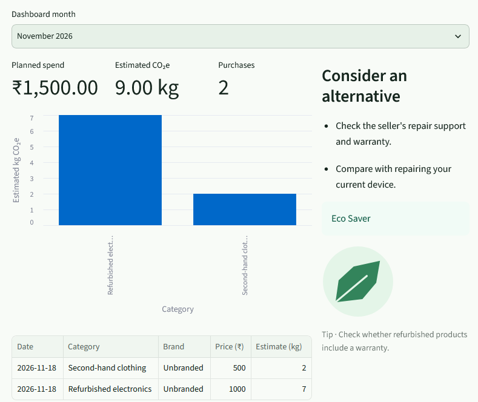

# ShopImpact

ShopImpact is a Streamlit dashboard for Scenario 1 of the Year 1 Python Programming SA. It estimates the impact of planned purchases, groups them by month, and suggests options such as repair, borrowing and second-hand shopping.

The dashboard shows a live estimate before adding a purchase. Its monthly view displays spend, estimated CO₂e, a category chart, the purchase log and badges. The Turtle badge drawing uses the same coordinates in the desktop preview and the hosted SVG.

## Run and test

Use Python 3.12.

```sh
python -m pip install -r requirements.txt
python -m streamlit run app.py
python -m unittest discover -s tests -v
python turtle_art.py
```

Tk is needed for the optional Turtle preview. The deployed dashboard renders the leaf as an SVG.

## Integration

- `app.py` handles Streamlit widgets, the live preview and session state.
- `model.py` validates input, calculates impact with decimal arithmetic, and summarizes purchases by year and month.
- `turtle_art.py` draws the badge and produces its browser graphic.
- [Design and test evidence](docs/design-and-testing.md) documents requirements and results.
- GitHub Actions runs model and syntax tests on pushes and pull requests.

## Method and limitations

Estimated kilograms of CO₂e equal price in rupees multiplied by an illustrative category factor. Factors are teaching assumptions. Price can vary for identical products, brand tags leave the factor unchanged, and the resulting estimates have no product certification. Session entries clear when the browser session resets.

## Deployment

In [Streamlit Community Cloud](https://share.streamlit.io), choose this repository, branch `main`, and entry point `app.py`. Select Python 3.12 in advanced settings. The app requires zero secrets.

**Live app** [Open ShopImpact](https://shopimpact-idai102.streamlit.app/)

## Screenshots

[Live purchase preview](docs/screenshots/purchase-preview.png)



## Sources

- [GHG Protocol Scope 3 calculation guidance](https://ghgprotocol.org/scope-3-calculation-guidance-2)
- [Python Turtle](https://docs.python.org/3/library/turtle.html)
- [Streamlit Community Cloud deployment](https://docs.streamlit.io/deploy/streamlit-community-cloud/deploy-your-app/deploy)

